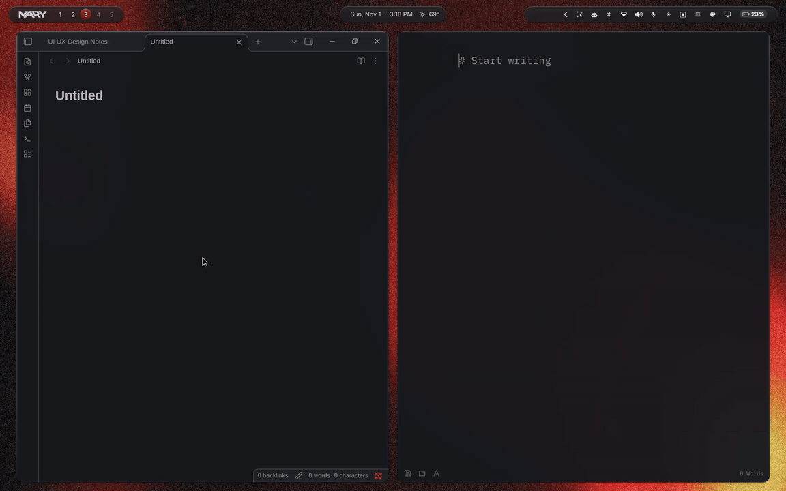
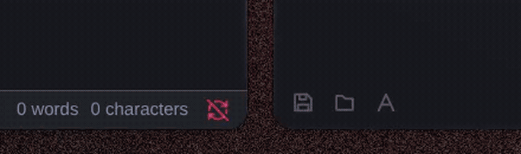
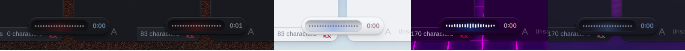
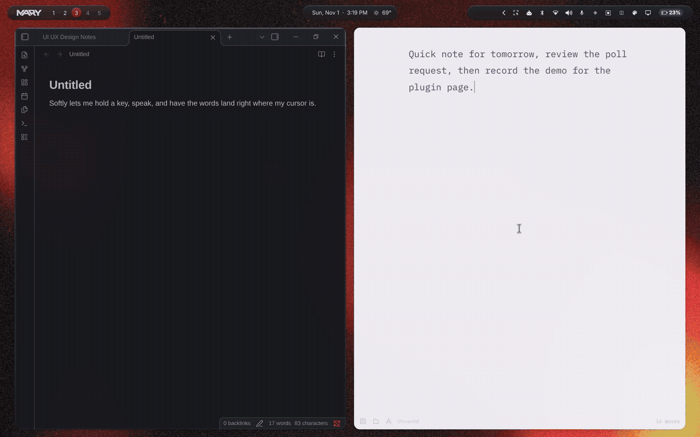
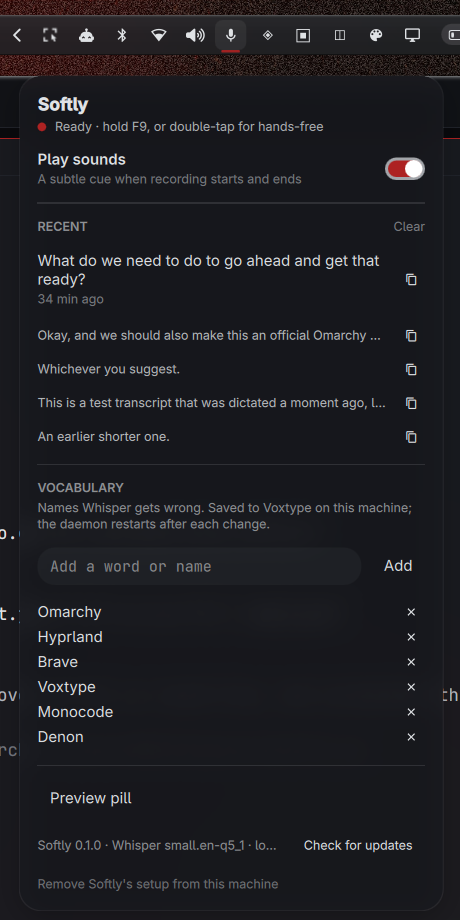

<div align="center">


<p><strong>Local Whisper dictation for Omarchy, with a pill that stays out of your way.</strong><br>
Tap a key, speak, tap again, and the words land where your cursor is. Nothing leaves the machine.</p>

<p>
<a href="https://github.com/denonmaryland/omarchy-softly/releases"></a>
<a href="https://omarchyplugins.com/"></a>


<a href="LICENSE"></a>
<a href="https://github.com/denonmaryland/softly"></a>
</p>



</div>

<br>

<table align="center">
<tr>
<td align="center" width="33%"><h3>Tap</h3>Tap <kbd>F9</kbd>, or the key you pick under Dictation key in the popover. The pill rises from the bottom of the screen with a live waveform and a timer.</td>
<td align="center" width="33%"><h3>Speak</h3>Say it however it comes. One tap and Softly keeps listening hands-free until you tap again; hold the key instead for push-to-talk.</td>
<td align="center" width="33%"><h3>Release</h3>Whisper runs on this machine, the groove dims while it works, and the text is pasted into the app you were in.</td>
</tr>
</table>

<br>

## Why Softly

<table>
<tr>
<td width="50%" valign="top"><strong>A pill, not a panel.</strong><br>One small capsule with a backlit groove. It appears when you press the key and leaves when the words have landed. Esc or the × cancels.</td>
<td width="50%" valign="top"><strong>Private by construction.</strong><br>Voxtype's Whisper model runs on your GPU or CPU. Audio stays in memory, the transcript stays on your clipboard, and the plugin never phones home except when you ask it to check for updates.</td>
</tr>
<tr>
<td width="50%" valign="top"><strong>Pastes like you would.</strong><br>Ctrl+V in normal apps, Shift+Insert in windows tagged as terminals, sent through Hyprland so Electron apps behave too. If a field refuses the paste, the text is still on the clipboard.</td>
<td width="50%" valign="top"><strong>The few settings that matter.</strong><br>Sounds on or off, a vocabulary of names Whisper gets wrong, the last few transcripts with copy buttons, status, and a preview of the pill. All in one popover on the bar.</td>
</tr>
</table>

## It follows your theme

The capsule, the groove's backlight and the bars take their colours from the Omarchy theme, so the pill looks like it was always part of the desktop. Switch themes and it switches with you.

<div align="center">

<br><br>

<br><br>

</div>

## The popover

Click the microphone in the bar. Everything Softly can be asked lives here, and it works from the keyboard: Up and Down move between rows, Enter activates.

<div align="center">

</div>

## Install

```bash
omarchy plugin add https://github.com/denonmaryland/omarchy-softly --enable
```

Works on **Omarchy 4.0.x and 4.5**. Then click the microphone icon in the bar and press **Set up Softly**. Softly only writes to your system after that press, and it backs every file up first (`name.bak.<time>-softly`). Prefer a different key? Set **Dictation key** in the widget's settings, then press **Apply** in the popover.

<details>
<summary><strong>What Set up writes</strong></summary>
<br>

1. `~/.local/bin/softly-paste`, the app-aware paste helper.
2. Voxtype's output settings in `~/.config/voxtype/config.toml`: clipboard output through that helper, Voxtype's own overlay and hotkey off.
3. `~/.config/hypr/softly.lua` for your dictation key, loaded by one marked line at the end of `~/.config/hypr/hyprland.lua`. With F9 it takes over Omarchy's own F9 dictation binding (stock on Omarchy 4.0; the 4.5 update keeps it in `bindings.lua` for people who already dictated); other keys leave F9 alone. On Omarchy 4.5 it also switches off Omarchy's Alt + Space and Right Alt dictation keys, unless you hand dictation to Omarchy (below).

</details>

<details>
<summary><strong>Omarchy 4.5's own dictation keys</strong></summary>
<br>

Omarchy 4.5 binds <kbd>Alt</kbd>+<kbd>Space</kbd> (toggle) and holding <kbd>Right Alt</kbd> to its own dictation, which runs the app picked under **Setup › Defaults › Dictation** (Voxtype or Superwhisper). Softly stays in charge by default: its module switches those two keys off, so Voxtype never starts twice and tap-to-start keeps working.

To use Omarchy's keys instead, open the popover's **Key, language & pill** page and pick **Omarchy dictation** under **Dictation keys**. Softly then binds no dictation key at all and leaves Omarchy's alone; pick **Softly** to get your key back. Nothing is registered with Omarchy and Voxtype's settings are not changed, so with Voxtype as Omarchy's app the pill, paste helper and fixes keep working. On Omarchy 4.0 the option is hidden and nothing changes.

</details>

<details>
<summary><strong>Files it touches</strong></summary>
<br>

| Path | Why |
|---|---|
| `~/.config/omarchy/softly.json` | settings: sounds, tap to start, fixes, pill style, who owns the dictation keys |
| `$XDG_RUNTIME_DIR/softly/` | recent transcripts (tmpfs, gone at logout) and paste state |
| `~/.config/voxtype/config.toml` | output settings, on Set up (backed up) |
| `~/.config/hypr/softly.lua`, one line in `hyprland.lua` | the key binding, on Set up (backed up) |
| `~/.local/bin/softly-paste` | the paste helper, on Set up |

</details>

<details>
<summary><strong>Dependencies</strong></summary>
<br>

**Voxtype**, the dictation daemon and its Whisper model. The plugin never installs it, only checks that it is there. On Omarchy 4.0 install it from **Install › AI › Dictation**; on Omarchy 4.5, where a fresh install defaults to Superwhisper, pick **Setup › Defaults › Dictation › Voxtype**. The rest is part of a stock Omarchy install: `wl-clipboard`, `jq`, `hyprctl`, `python3`. No sudo or pkexec is required. The only service it touches is your own user-level `voxtype` service, restarted after a vocabulary change or Set up. Network access happens only when you press **Check for updates**, which reads the latest release tag on GitHub; updates install through `omarchy plugin update`.

</details>

<details>
<summary><strong>Remove</strong></summary>
<br>

In the popover, **Remove Softly's setup from this machine** undoes the three writes above: Voxtype keys go back to their defaults, the Hyprland line and module are removed, the helper is deleted. Then:

```bash
omarchy plugin remove io.github.denonmaryland.softly
```

Your vocabulary stays in Voxtype's config. The sounds setting lives in `~/.config/omarchy/softly.json` and can be deleted.

</details>

## Same pill, other desks

Softly also runs on **macOS** and **Windows**, with the same pill and the same gesture rules. Both live in the [Softly repo](https://github.com/denonmaryland/softly), where this plugin's source is kept under `Linux/plugin` and published here on every release.

<br>

<div align="center">
<sub>MIT licensed · built on <a href="https://omarchy.org">Omarchy</a>, <a href="https://voxtype.io">Voxtype</a> and whisper.cpp · made by <a href="https://github.com/denonmaryland">denonmaryland</a></sub>
</div>
