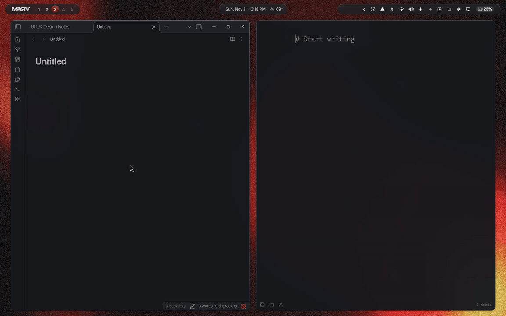

<div align="center">


<p><strong>Hold a key, speak, release. The words land where your cursor is.</strong><br>
Local Whisper dictation with the same quiet backlit pill on macOS, Windows and Omarchy Linux. Nothing leaves the machine.</p>

<p>
<a href="https://github.com/denonmaryland/softly/releases"></a>


<a href="https://github.com/denonmaryland/omarchy-softly"></a>
<a href="https://github.com/denonmaryland/softly/blob/main/VERSION"></a>
</p>



</div>

<br>

<table align="center">
<tr>
<td align="center" width="33%"><h3>Hold</h3>Right Option on the Mac, Right Alt on Windows, F9 on Omarchy. The pill rises with a live waveform and a timer.</td>
<td align="center" width="33%"><h3>Speak</h3>Double-tap instead of holding and Softly keeps listening hands-free until you press again. Esc or the × cancels.</td>
<td align="center" width="33%"><h3>Release</h3>Whisper runs on the machine, the groove dims while it works, and the text is pasted into the app you were in. It stays on the clipboard too.</td>
</tr>
</table>

<br>

## One pill, three desks

<table>
<tr>
<th width="33%">macOS</th>
<th width="33%">Windows</th>
<th width="33%">Omarchy Linux</th>
</tr>
<tr>
<td valign="top">Menu-bar app in Swift. whisper.cpp with Metal, a SwiftUI pill in a non-activating panel, paste through ⌘V, Music and Spotify pause while you talk. Settings window with Home, Vocabulary and Preferences. <a href="#the-mac-app">Below.</a></td>
<td valign="top">Tray app in .NET 8 and WPF. Whisper.net on Vulkan when the GPU allows it, a low-level hook on Right Alt, WASAPI capture, system media sessions pause, the same settings window. <a href="Windows/README.md">Windows/README.md</a></td>
<td valign="top">An Omarchy plugin on Voxtype: the pill follows your theme, and a bar popover holds sounds, recent transcripts, vocabulary, status and updates. <a href="https://github.com/denonmaryland/omarchy-softly">omarchy-softly</a></td>
</tr>
</table>

<div align="center">

</div>

The gesture rules, the easing, the glyph morph and the waveform are one piece of logic ported three times, with the same tests on each platform (`Sources/DictationCore`, `Windows/Softly.Core`, `Linux/plugin/Controller.js`).

## Updates

Every copy checks GitHub Releases quietly a few hours apart and offers the new build in Preferences (Mac and Windows) or the bar popover (Linux). To ship one: `scripts/release.sh X.Y.Z` bumps the version on all three platforms, tags, and pushes; GitHub Actions builds the Mac app, the Windows app and the Omarchy plugin, attaches them to the release, and publishes the plugin to its own repo.

<br>

# The Windows app

Windows 10 or 11, 64-bit. A GPU with Vulkan makes transcription fast; without one it runs on the CPU.

1. Download `Softly-windows.zip` from the [latest release](https://github.com/denonmaryland/softly/releases/latest) and unzip it anywhere, for example `C:\Softly`.
2. Run **Softly.exe**. The build is not code-signed, so SmartScreen shows "Windows protected your PC": press **More info**, then **Run anyway**. Nothing else needs installing; .NET is bundled.
3. Softly opens its window. Press **Download speech model** (181 MB, once). The file is verified and kept in `%LOCALAPPDATA%\Softly\Models`.
4. Hold **Right Alt** and talk. The tray icon opens the settings window and offers updates.

Details and the build steps are in [Windows/README.md](Windows/README.md).

<br>

# The Mac app

A menu-bar dictation app for the Mac, ported from the Omarchy plugin. It uses the same local Whisper model and settings and draws the same backlit-groove pill with the same motion. Nothing leaves the Mac.

### How it works

- Hold **Right Option (⌥)** to dictate; release to transcribe and paste.
- **Double-tap** Right Option for hands-free mode; press it again to finish.
- **Esc**, or clicking the **×** that appears when you hover the timer,
  cancels and discards. Esc is only intercepted while the pill is showing.
- Typing another key while holding Right Option (an Option shortcut or an
  accented character) discards the recording instead of dictating.
- The transcript is pasted with ⌘V into the app you were in. It stays on the
  clipboard afterwards, as on Linux, so you can paste it again.
- Recording is capped at 15 minutes. Audio is held in memory only.
- Music and Spotify pause while you record and resume afterwards, as Voxtype
  does on Linux. macOS asks once per app for Automation access. Off switch in
  Preferences.
- **Open Softly…** in the menu-bar menu (or ⌘, while the window is
  up) opens the window: Home shows status and a practice box, Vocabulary
  edits the names Whisper is hinted with, Preferences has sounds, microphone,
  model status and the three permissions. The window also opens on its own
  when a permission or the model is missing.

| Part | Linux original | Mac version |
|---|---|---|
| Speech model | Voxtype + whisper.cpp (Vulkan), `ggml-small.en-q5_1.bin` | whisper.cpp xcframework (Metal), same model file |
| Settings | English, flash attention, 4 threads, vocabulary prompt | Same, in `Sources/Softly/Settings.swift` |
| Gestures | `Controller.js` | `GestureController.swift` (same rules, same tests) |
| Pill | Quickshell QML | SwiftUI Canvas in a non-activating `NSPanel` |
| Paste | `voxtype-app-paste` + Hyprland | `NSPasteboard` + synthetic ⌘V |
| Accent colour | Omarchy theme | macOS accent colour (System Settings → Appearance) |
| Settings | Bar popover (sounds, vocabulary, status) | Window (Home, Vocabulary, Preferences) |
| Media pausing | Voxtype `pause_media` (MPRIS) | `MediaPauser.swift` (Music, Spotify via AppleScript) |

### Layout

```
Package.swift                SwiftPM package (macOS 14+)
Sources/DictationCore/       Gestures, easing/tweens, glyph morph, waveform, transcript cleanup
Sources/Softly/      App: menu bar, hotkey tap, mic, Whisper, paste, pill, window
Tests/DictationCoreTests/    Unit tests for the core (also run on Linux)
Windows/                     Softly for Windows (.NET 8, WPF, Whisper.net); own README
Resources/                   Info.plist, open/close sound cues
scripts/build-app.sh         Builds and signs "Softly.app"
scripts/fetch-model.sh       Downloads and verifies the Whisper model
docs/ui-spec.md              Window and pill spec from the Paper design (direction 01)
Linux/plugin/                The Omarchy plugin, published to github.com/denonmaryland/omarchy-softly
VERSION, scripts/release.sh  One version for all platforms; release.sh tags and pushes
.github/workflows/release.yml Builds and publishes all three on a v* tag
.github/workflows/build.yml  Optional macOS CI build (only if pushed to GitHub)
```

### Install

Apple Silicon, macOS 14 or later.

1. Download `Softly-mac.zip` from the [latest release](https://github.com/denonmaryland/softly/releases/latest), unzip it, and drag **Softly.app** into Applications.
2. Open it once. The build is signed but not notarized with Apple, so macOS refuses the first launch. Go to **System Settings → Privacy & Security**, scroll down, and press **Open Anyway** next to Softly. Or, in Terminal:

   ```bash
   xattr -dr com.apple.quarantine /Applications/Softly.app
   ```

3. Softly opens its window. Press **Download speech model** (181 MB, once). The file is verified and kept in `~/Library/Application Support/Softly/Models`.
4. Grant **Microphone**, **Input Monitoring** and **Accessibility** when asked. Input Monitoring is for the Right Option hotkey; Accessibility is for pasting with ⌘V and intercepting Esc. The menu-bar icon shows a badge until all three are in place, and its menu links to each settings pane.
5. Hold **Right ⌥** and talk.

Updates arrive through **Check for Updates** in the menu; the window offers the new build when one is out.

### Build from source

Requirements: macOS 14 or later, Xcode 16 or later (open it once to accept the
licence).

```bash
git clone https://github.com/denonmaryland/softly ~/Projects/softly
cd ~/Projects/softly
swift test                      # core logic tests
scripts/build-app.sh --install  # builds, installs to ~/Applications, launches
```

The app downloads the model on first run; `scripts/fetch-model.sh` does the
same from the command line.

#### Keeping permissions across rebuilds

Ad-hoc signed builds can make macOS forget the Input Monitoring and
Accessibility grants after each rebuild. To avoid that, create a local signing
certificate once:

1. Open Keychain Access → Certificate Assistant → Create a Certificate…
2. Name it **Softly Local**, Identity Type *Self Signed Root*,
   Certificate Type *Code Signing*.

`build-app.sh` uses it automatically when present.

### Customizing

- Vocabulary: the window's Vocabulary view (stored in UserDefaults; first-run
  defaults in `Settings.defaultVocabulary`). Language, threads: `Settings.swift`.
- Hotkey: `HotkeyMonitor.swift` (`triggerKeyCode`, `rightOptionMask`).
- Pill colours: `Palette.swift`. Motion timings: `PillModel.swift`.

### Known limitations

- Paste sends the physical V key with ⌘. Non-QWERTY layouts (for example
  Dvorak) may need a layout-aware key code.
- Bluetooth headsets switch to a lower-quality microphone profile while
  recording, which can reduce accuracy. The built-in microphone avoids this.
- The Preferences window shows the shortcut and microphone but does not let
  you change them yet; both follow the code and the system input device.
- Recordings whose loudest moment stays under `Settings.silenceRMS` (0.005)
  are skipped, because Whisper invents text for silence. If soft speech is
  being dropped, lower it.
- If the microphone changes mid-recording (for example AirPods connect), the
  recording stops and what was captured is transcribed.
- The pill appears on the screen under the pointer, above the Dock.

<br>

<div align="center">
<sub>MIT licensed · whisper.cpp by ggml · made by <a href="https://github.com/denonmaryland">denonmaryland</a></sub>
</div>
